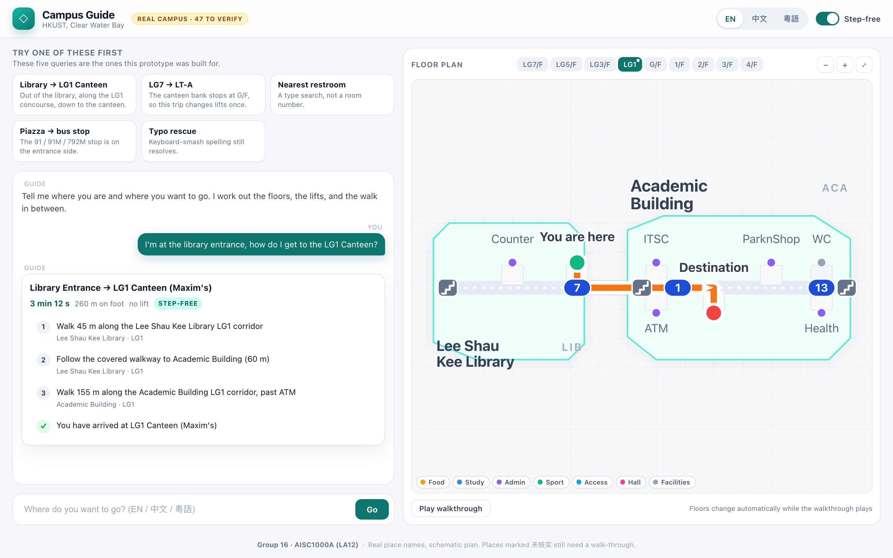
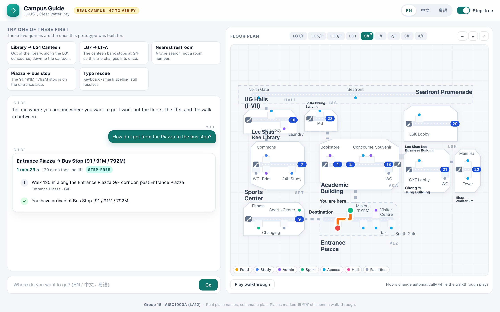
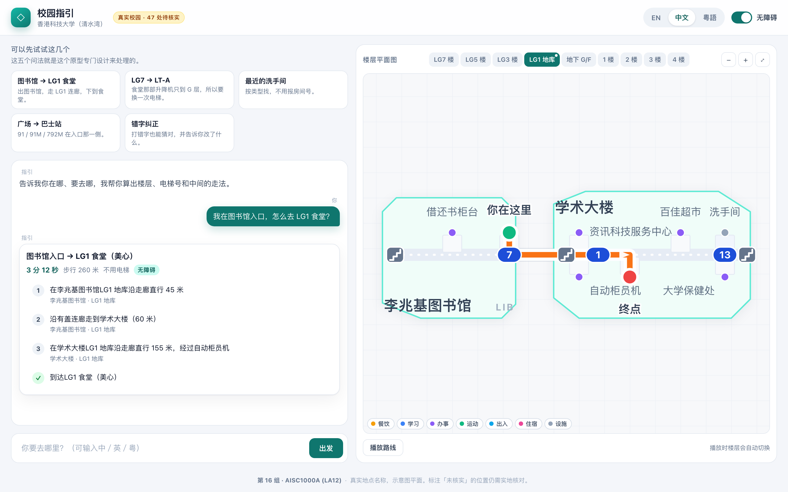
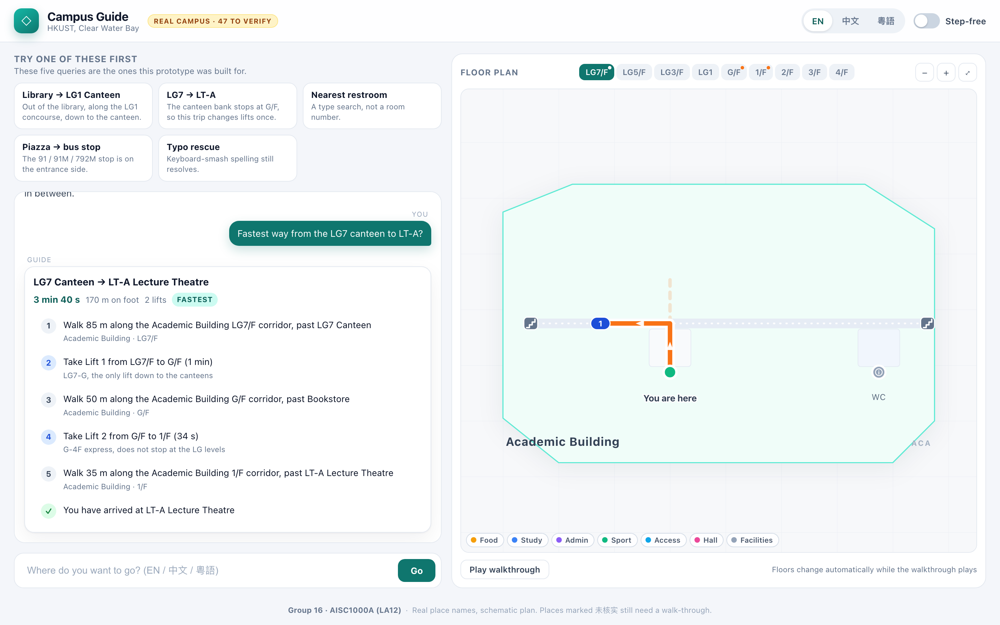
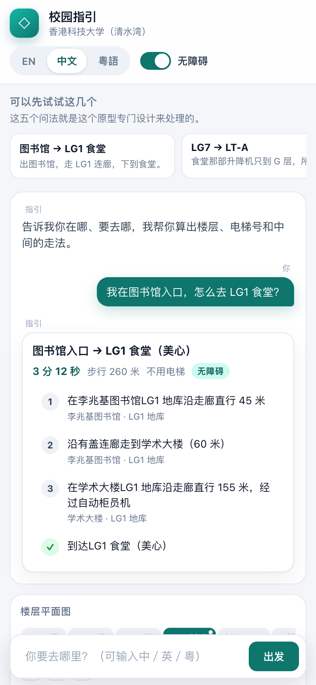

# Freefish Campus Guide

An indoor campus wayfinding prototype: you type where you are and where you
want to go, and it answers with a numbered, lift-aware route plus a floor
plan that follows along.

Built for **AISC1000A (LA12) — Group 16**. It now runs on **real HKUST place
names** (Clear Water Bay campus); the original fictional campus is still in the
repo as `?data=demo` because the test suite asserts exact routes on it.

**Live demo — <https://freefish0904.github.io/freefish-campus-guide/>**

Try a deep link: `?q=library+to+LG1+canteen&lang=en`,
`?q=我在图书馆入口，怎么去+LG1+食堂&lang=zh`, or add `&sf=0` to switch step-free
off. Add `&data=demo` for the fictional campus.



## Two campuses, one engine

| | `?data=ust` (default) | `?data=demo` |
|---|---|---|
| Place names | real (Academic Building, Lee Shau Kee Library, LSK, CYT, Shaw Auditorium, UG Halls…) | invented |
| Floors | LG7 / LG5 / LG3 / LG1 / G / 1F-4F | LG1 / G / 1F-8F |
| Buildings on the plan | 10 (incl. the piazza and the sea-front promenade as open ground) | 6 |
| Points of interest | 64 | 57 |
| Used by | the app, the screenshots | the 49-case suite, the layout checker |

**Where the real data comes from**, and what is still unverified:

- `data/ust-newcomer.txt` — the newcomer guide this prototype is built around:
  LG1 canteen, LG5 McDonald's, LG7 canteen, the G/F 24-hour study area, the
  library's top-floor sea-view seats, the LSK canteen and study room, the CYT
  Bloomberg terminals, the E2 computer room, the free pool, ParknShop, the
  bookstore, Su store, the Students' Union store.
- <https://www.hkust.edu.hk/visit> — minibus 11 (Choi Hung), 11M (Hang Hau),
  104 (Ngau Tau Kok), bus 91 (Clear Water Bay), 91M (Po Lam), 792M (Tiu Keng
  Leng / Sai Kung), and the southern entrance as the drop-off.
- <https://library.hkust.edu.hk> — Learning Commons, group study rooms, nap
  pods, 3D printing, print/copy station.

Everything that could not be confirmed on paper carries `verified: false` and
the plan prints a **未核实** marker for it: the *position* and *floor* of most
places, and the lift numbers. The pattern is the real one — HKUST numbers its
lifts campus-wide and splits the Academic Building over LG7/LG5/LG3/LG1, so
going from LG7 to a 1/F lecture theatre costs two lifts — but the individual
numbers are a first pass to be checked with a walk-through. The header counts
them: **REAL CAMPUS · 47 to verify**.

## What it does

- **Understands three languages** — English, 中文 and 粵語 (traditional,
  Hong Kong style) — in one box, with typo tolerance and synonym/alias
  matching. Room codes (`LT-1`, `CR-101`, `Lab 402`) and building + floor
  ("工程附樓 7 樓") both work.
- **Plans real indoor routes** — Dijkstra over a hand-built graph of
  corridors, stairs, an escalator, six lift shafts, a skybridge and a
  covered walkway.
- **Takes accessibility seriously** — a *Step-free* mode that refuses stairs
  and escalators, plus a side-by-side time comparison with the fastest route.
- **Explains the odd bits** — "Lift 2 does not serve LG1", "Lift 4 is the
  only step-free way into the Annex", "the Library has no ground-level door".
- **Draws the answer** — a floor plan per level with real building footprints,
  category-coloured places, zoom/pan and three levels of detail, route
  highlighted, floors switching automatically during the walkthrough animation.
- **Re-translates live** — switching language re-renders the route that is
  already on screen instead of starting over.

## Run it

No build, no dependencies, no backend.

```bash
# simplest: just open the file
open index.html            # macOS
# or serve it
python3 -m http.server 8000
```

The app uses plain `<script>` tags on purpose, so it also works from
`file://` without a server.

## Try these

| Query | What it demonstrates |
|---|---|
| `I'm at the library entrance, how do I get to the LG1 Canteen?` | out of the library, along the LG1 concourse |
| `Fastest way from the LG7 canteen to LT-A?` | two lift banks, because the LG bank stops at G/F |
| `Where's the nearest restroom? I'm in the Academic Concourse.` | nearest-POI search |
| `How do I get from the Piazza to the bus stop?` | the 91 / 91M / 792M stop |
| `libary seaview to lg 1 canteen pls` | typo rescue |

With `&data=demo`, the originals still work (`Library main entrance → LT-1`,
`工程附楼 7 楼`, `LT-1` typos, and the Lift 2 / LG1 trap).

More detail in [`docs/SAMPLE_QUERIES.md`](docs/SAMPLE_QUERIES.md).

## How it is put together

```
index.html              one page, twelve <script> tags
styles.css              all styling, including the SVG floor plan
src/data/graph.js       buildCampus(spec): spec -> nodes, edges, lookups
src/data/campus.js      the fictional demo campus (spec + build)
src/data/campus.ust.js  HKUST Clear Water Bay (spec + build, with sources)
src/data/active.js      picks the campus: ?data=demo | ?data=ust (default)
src/data/scenarios.js   five queries per campus, in three languages
src/icons.js            POI categories + the seven inline SVG icons
src/i18n.js             every UI string in EN / 中文 / 粵語
src/nlu.js              normalisation, segmentation, entity matching, typos
src/router.js           Dijkstra, step-free filter, nearest-POI search
src/steps.js            path -> walk / lift / stairs segments with landmarks
src/map.js              SVG floor plans + walkthrough player
src/app.js              state, chat thread, wiring
tests/                  graph + data checkers, 49-case suite, browser checks
docs/                   test log, sample queries, deploy guide, screenshots
```

**Data model.** A campus is a *spec*: buildings with a footprint (`rect` for the
bounding box, optional `outline` polygon for the real shape, `kind: 'open'` for
ground like a piazza), one horizontal *spine* per building, rooms that hang off
the nearest spine node, vertical *cores* (lifts/stairs) with the floors they
serve, and building-to-building links. `graph.js` turns that into the walking
graph, so timetables and maps can never disagree. Adding a campus means adding
one spec file — which is exactly what `campus.ust.js` is.

**The plan.** `map.js` draws one floor at a time in four layers: paper, walls and
corridors, the route, then rooms and words. Labels are placed by measuring each
one with `getBBox()` against everything already on the floor (route, cores,
other labels, the walls of its building) instead of using fixed offsets. Zoom is
a window over the same 1000x660 map units, and marker/type sizes are divided by
`--u` (units per CSS pixel) so text stays the same size on screen while the
geometry grows: three levels of detail pick which labels are worth drawing.

**Cost model.** Walking is `metres / 1.35 m/s`; stairs are 16 s per floor;
a lift ride is `wait + per-floor` with the wait charged once per ride; an
escalator is 22 s. Step-free mode removes every edge flagged
`accessible: false`.

## Tests

```bash
node tests/check_graph.js     # data integrity for BOTH campuses
node tests/run_tests.js       # 49 cases / 602 assertions -> docs/TEST_RESULTS.md
python3 tests/browser_check.py  # smoke + label layout, headless Chrome
open tests/smoke.html         # 21 UI checks, driven in a real browser
open tests/layout_check.html  # label layout: every floor x language x scenario
python3 tests/screenshots.py  # regenerate docs/screenshots
```

`layout_check.html` measures every `<text>` with `getBBox()` after each render
and fails if a label touches another label, a lift box, the route line, the
canvas edge, or the walls of its own building. It runs once per campus:
**demo 72 renders / 1273 texts / 0 problems**, **HKUST 48 renders / 999 texts /
0 problems**. Add `?data=ust&lang=en&floor=G&dump` to print the computed boxes.

Current status: **49 cases, 602 assertions, 0 failures; 21 UI checks, 0 script
errors; 0 label collisions on either campus**. Details and the bugs found on
the way are in [`docs/TEST_LOG.md`](docs/TEST_LOG.md).

## Map controls

| | |
|---|---|
| Wheel | zoom is anchored on the cursor; drag to pan |
| Double-click | zoom in on that spot |
| − / + / ⤢ | zoom out, zoom in, fit the campus back in the pane |
| Legend chips | click a category to fade everything else |
| `?zoom=2.2` | deep link that opens the plan at a reading distance |

Zooming changes how much is drawn, not just how big: below 0.92× only building
names survive, 0.92–1.7× adds room names, above 1.7× adds category icons.

## Screenshots

| | |
|---|---|
|  |  |
| G/F: the whole campus, piazza → bus stop | 中文, library → LG1 canteen |
|  |  |
| LG7 → LT-A: two lift banks, fastest | 390 × 844 phone layout |

## Known limitations

- 64 points of interest on the HKUST plan - the newcomer-relevant slice (food,
  study, transport, admin), not the whole campus.
- 47 of them are marked 未核实: the place is real, its position or floor is not
  confirmed yet. Lift numbers and the exact geometry still need a walk-through.
- Lift waiting times, walking speed and floor heights are constants, not live
  data, so ETAs are estimates.
- No voice input, no turn-by-turn GPS, no live lift status.
- The floor plan is schematic: buildings sit in their true relative position but
  the drawing is compressed, so long uphill paths carry an explicit travel time
  instead of a surveyed distance.
- Two-finger pinch is not wired up yet: on a phone the map pans with one finger
  and zooms with the ± buttons.

## Deploying

Static hosting only — [`docs/DEPLOY.md`](docs/DEPLOY.md) has the drag-and-drop
GitHub Pages steps.

---

Group 16 · AISC1000A (LA12) · course prototype, fictional campus data.
