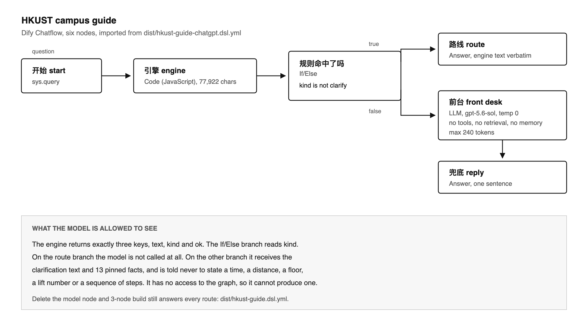
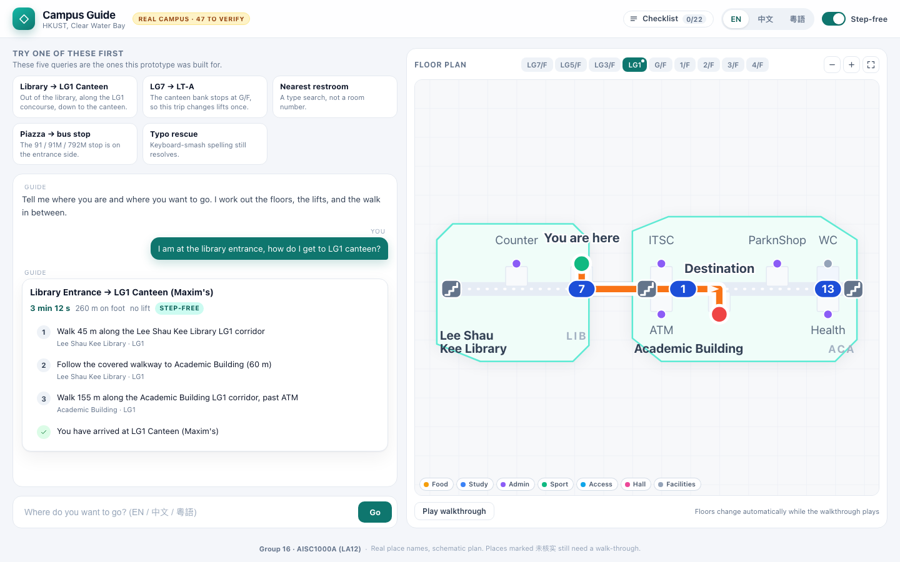
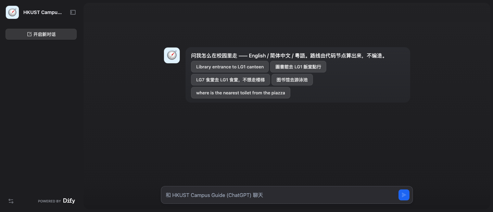

# Team submission

*AISC1000A (LA12), Group 16. Campus guide: a wayfinding chat for HKUST newcomers.*

Everything below can be checked against the repository at
<https://github.com/FreeFish0904/freefish-campus-guide>. Where a number appears, the
command that produces it is not far away.

## 1. Use case statement

HKUST is hard to walk around, and the hard part is rarely which building. It is the
last twenty metres: the Academic Building runs from LG7 to 4F, the lifts do not all
serve the same floors, the library has no door at ground level, and the walkway between
them exists only on LG1. The signs are on the floor you are already standing on.

The app is for a first-year or exchange student in week one, for open-day visitors, and
for a student who cannot use stairs, for whom a route with a flight in it is the wrong
route, not a slower one.

One sentence in English, 中文 or 粵語, typos included, comes back as a route with a
time, a distance, the floors and the lifts. That works when every number can be
recomputed from the published map, step-free never returns a stair, the browser and the
chat return the same route text, and routes still answer with the model deleted.

That last test answers CILO 3 and 4. The engine owns the numbers, because a number can
be checked against a graph. The model owns one sentence, all that is left when the rules
fail. The team owns the data, the accessibility default and the release, judgements no
test can invent.

## 2. Technical documentation

### 2.1 What the app actually is

The links in section 5 point at one Dify Chatflow with six nodes, imported from
`dist/hkust-guide-chatgpt.dsl.yml`. Start passes the question to a Code node that
carries the whole engine, around 78,000 characters of JavaScript bundled from the
same files the browser loads, which is the reason the two front ends cannot drift
apart. An If/Else node then looks at what kind of answer came back. If the engine
recognised the question, an answer node prints its text unchanged. If it did not,
the LLM writes a short reply from the clarification and a second answer node returns
that.

| node | type | what the file sets |
|---|---|---|
| 开始 start | Start | one variable in use: `sys.query` |
| 引擎 engine | Code (JavaScript) | input `query` = `{{#sys.query#}}`; body is `dist/dify-code-node.js`, 77,922 characters; outputs exactly `text`, `kind`, `ok` |
| 规则命中了吗 rules | If/Else | case `true`: `[9000000000002, kind]` **is not** `clarify` |
| 路线 route | Answer | `{{#9000000000002.text#}}`, the engine text printed verbatim |
| 前台 front desk | LLM | `openai / gpt-5.6-sol`, temperature 0, `max_tokens` 240, memory window off, context off, vision off |
| 兜底 reply | Answer | `{{#9000000000005.text#}}` |

The published app runs on `openai / gpt-5.6-sol` at temperature 0 and 240 tokens, with
memory off, context off, vision off, no knowledge base attached and no tool the model
can call. App level it is an advanced chat: no conversation variables, retriever
resources disabled, file upload off, speech in and out off, sensitive word avoidance
off.

There is a second file, `dist/hkust-guide.dsl.yml`, which is the same flow with the
LLM node, the fallback answer and the if/else deleted. Three nodes, and every route
still answers.
We kept it because the claim that the model is optional is easy to write and hard to
believe without something that runs.



*Figure 1. The flow as imported, drawn from the DSL file rather than captured from
the console: six nodes, the branch on kind, and a note on what the model can see.*

### 2.2 The import that failed, and why we are writing it down

Our first import into Dify died before anyone could ask it a question. A Code node
declares its outputs, and Dify compares the number of keys the code returns with the
number declared; `CodeNode._transform_result` ends with

```python
if len(parameters_validated) != len(result):
    raise CodeNodeError("Not all output parameters are validated.")
```

The engine knows more than the flow needs, since it also computes seconds, the step
list, the lifts used and the origin id. The first version of `main()` returned the whole
answer object, which is 21 keys on a route and 23 on a nearest-place answer, and the
node refused it. Declaring three outputs and returning exactly those three, `text`,
`kind` and `ok`, was the whole fix, and the rest of what the engine computes stays
inside the node. If whoever imports this next year gets an error on the first run, that
is usually the reason.

### 2.3 The knowledge base, described honestly

A Dify app with a chat window usually has a document library behind it. This one does
not. There is no vector store and no embedding model; the knowledge base is a single
hand-written file, `src/data/campus.ust.js`, which builds a graph from a spec of
buildings, floors, rooms and connections.

We chose that because the answer is arithmetic rather than a passage. "3 min 12 s ·
260 m · no lift" cannot be retrieved from anything; it comes out of a shortest path
over edges that carry a length, a floor and a kind. A passage retriever could hand
back the paragraph about LG1 canteen, but it could not promise that the path implied
by that paragraph has no stairs in it, and for the reader who asked for step-free
that promise is the answer.

| source | what it gave us |
|---|---|
| `data/ust-newcomer.txt` | the newcomer guide this prototype is built around: LG1 canteen, LG5 McDonald's, LG7 canteen, the G/F 24-hour study area, the library's top-floor sea-view seats, the LSK canteen and study room, the CYT Bloomberg terminals, the E2 computer room, the pool, ParknShop and the G/F bookstore |
| <https://www.hkust.edu.hk/visit> | minibus 11 and 11M, bus 91, 91M, 792M and 104, the southern entrance as the drop-off |
| <https://library.hkust.edu.hk> | Learning Commons, group study rooms, nap pods, 3D printing, the print and copy station |

What is in the graph is 10 buildings, 64 places, 9 levels (LG7 to 4F), 240 nodes and
291 edges. That is a slice of the campus rather than the campus: food, study space,
transport, admin and a few facilities, which is what someone needs in their first
week. The app never suggests it knows more than that, and "I cannot find X in this
campus map" is a real answer it gives.

Building it took four passes. Places became nodes with a building, a floor, a
position, a category and a name in three languages plus aliases. Connections became
typed edges, corridor, stairs, lift, covered walkway and open-air link, each drawn
inside its building footprint, with lift cores joining every pair of floors they
actually serve. Names went through alias tables in EN, 中文 and 粵語 and a traditional
to simplified fold applied to both the input and the keywords, plus patterns for room
codes and "building plus floor". And doubt got written down rather than smoothed
out, which is the fourth pass and the least comfortable one: 37 of the 64 places and
10 of the 19 cores carry `verified: false` (those ten cores are every lift in the
slice), the header counts 47, and the footer says what 未核实 means.

Answering a question is not cosine similarity either. A word index matches names and
aliases, then a Levenshtein pass looks at words of five letters or more, one edit
allowed at five letters and two from six up. A hit is kept at 0.7 confidence, so
"libary to lg 1 canteen" comes back as a route rather than a question. Then Dijkstra
runs, and the steps are rendered in the language the question was asked in.

The one place a corpus would have helped is opening hours, and we left them out rather
than guess. The last rule in the prompt is that the model may answer a non-routing
question only if the engine's reply already says it, and otherwise says it does not
know. Hours change every term, so a corpus would need maintaining more often than the
graph does.

### 2.4 The browser build

The engine also runs outside Dify, which is how it was written. `index.html` loads
`src/` directly, the floor plan is inline SVG and the route is drawn on top of it, and
both front ends answer from the same bundled code. That is why a disagreement between
them would be a real bug and not a rounding difference, and why `check_bundle` refuses
to let `dist/` drift.



*Figure 2. The browser app on sample question 1: 3 min 12 s, 260 m, step-free, three
steps, and the LG1 plan with the route drawn.*

Three console captures that belong with 2.1 are still missing, because they need the
`cloud.dify.ai` login: the canvas, the Code node panel and the LLM node panel.
`docs/screenshots/` has a README saying what has to be visible in each, down to the
engine hash, so whoever holds the account can take them in a couple of minutes.

### 2.5 Rebuilding any of this

```bash
node tools/bundle_engine.js     # rebuild dist/ from src/, prints the engine hash
node tools/make_dsl.js          # regenerate both .dsl.yml files
node tests/check_bundle.js      # 116: dist/ is fresh, sandbox-safe, byte-identical
node tests/check_sandbox.js     # 42: strict mode, no console, junk input, size limits
node tests/check_dsl.js         # 204: both DSL files parse, wire up and execute
```

## 3. Tests and validation

### 3.1 What was run

| suite | what it does | result |
|---|---|---|
| `node tests/run_tests` | 49 cases over routing, parsing, rendering and the answer contract | 641 assertions, 0 failures |
| `node tests/check_bundle` | guards `dist/` against a stale or hand-edited bundle | 116 checks, 0 failures |
| `node tests/check_sandbox` | runs the engine in a sealed context with no console, no `require`, junk input and size limits | 42 checks, 0 failures |
| `node tests/check_dsl` | parses both DSL files, checks the wiring and executes `main()` for each preset question | 204 checks, 0 failures |
| `node tests/check_graph`, `check_campus` | the graph on both campuses: every edge inside its own building, step-free reach, the newcomer checklist | all pass |
| `python3 tests/browser_check.py` | the interface in headless Chrome: 30 UI checks, every label on every floor, every printable character | 30 smoke, 132 and 102 renders with no collisions, 921 glyph checks |

The argument for writing all of that is the bug list in `docs/TEST_LOG.md`, which runs
to nine entries. Three of them would have shipped. Lift waiting time was being charged
per floor, so a route that climbed three floors reported 66 s instead of 30 s. The
step-free filter only knew traditional characters, so 唔想行楼梯 typed in simplified was
read as an ordinary request and came back with a flight in it. The map labels piled up
on each other until the text was unreadable, because every label had been measured while
its group was still detached from the document. The first two would have surfaced as a
wrong answer; the third only surfaced in a picture.

### 3.2 Hallucination, citation and errors

The obvious worry with a language model in a wayfinding app is invented detail, so it
is worth being exact about where each number comes from. Times, distances, floors,
lift numbers and the order of the steps exist only in the router's output, and 641
assertions compare them against exact strings. On the route branch the model is not
called at all. On the other branch it receives the user's question and the text the
engine wrote, and its first rule forbids inventing a route, a distance, a floor or a
walking time. Ask it "how long does it take" and no route can be built from it, so the
engine returns a clarification and the model may only rephrase that.

Citation is the weaker of the three and we would rather say so. Every fact traces to
one of three sources, all three listed in `meta.sources`, and anything we have not
walked is counted in the header rather than stated flatly. The answer itself carries no
passage reference, because nothing is retrieved. Provenance here is enforced when the
data is written, not when the answer is generated. For a graph that is a defensible
choice. It is not the same thing as citing a document, and a reader looking for
footnotes will not find them.

Errors got the most attention, because they are what a user actually meets. Gibberish
comes back as a clarification with examples. A missing origin gets one question and
the likely places. An unknown name gets "I cannot find X in this campus map" and the
nearest candidates. A typo still gets a route: "libary to lg 1 canteen" resolves to
Library Entrance, and the browser prints which word it read. If the model is
unavailable or the account runs out of credit, routes keep working, because they never
go through it. A wrong key count fails the node loudly instead of returning half an
answer, which is the failure that taught us to write 2.2.

```
Q: Library entrance to LG1 canteen
A: Library Entrance → LG1 Canteen (Maxim's)
   3 min 12 s · 260 m on foot · no lift · Step-free
   1. Walk 45 m along the Lee Shau Kee Library LG1 corridor
   2. Follow the covered walkway to Academic Building (60 m)
   3. Walk 155 m along the Academic Building LG1 corridor, past ATM
   ✓ You have arrived at LG1 Canteen (Maxim's)
```

### 3.3 Acceptance on the deployed app

| check | status |
|---|---|
| The Dify app answers, and the answer is the route text the local build produces | pass on the first two suggested questions |
| A route never contains a stair the user did not allow | pass, enforced by the edge filter |
| Step-free is on by default, and asking for a lift route never removes a lift because the walk looks long | pass |
| An unknown word, a missing origin or gibberish produces a question, not a guessed route | pass, four cases in the suite |
| An unreachable pair says so and admits uncertainty | pass |
| The data names its three sources, and anything we have not walked is counted, not glossed over | pass: `meta.sources`, and a header badge counting 47 to verify |
| The same question twice gives the same text | pass, on each of the six suites in 3.1 |
| One hand-written data file rebuilds every artefact, hash printed | pass, `a2762b3892aa` |

### 3.4 What is still unproven

Walking the campus. Nothing here replaces a person standing in a corridor checking that
the edge exists, and 47 unverified items is our own count of that gap. A timed study
with someone who does not know the campus, since no usability session has run. The
cloud model's behaviour under load, because we have tested it for a day rather than a
semester. And the console captures in 2.1.

The honest summary is that the routing logic is tested far more thoroughly than it has
been used. We think that is the right bias for a project where a wrong answer sends
someone to the wrong end of the Academic Building, but it is a bias and it should be
visible.

## 4. How we split the work

We started from a small observation. Someone standing in a lift lobby does not need a
chatbot that sounds confident; they need a floor and a lift number they can act on, and
a wrong one costs them ten minutes and some trust. The easy build is to paste the
newcomer guide into a prompt and let a model answer. That demos well and fails the
first time it sends someone to LG1 in Lift 2, a floor that lift does not serve, in the
same confident voice.

Once we had said that out loud, the split followed: each part does the work it can be
held to. The engine is held to the graph: 240 nodes, 291 edges, 641 assertions
recomputing the same times from the same data. The model is held to a short list of
constraints we can read out loud: no route, no numbers, three sentences, temperature 0.
The team is held to the walk-through, which has not happened, which is why the header
counts 47 items to verify.

Three things we did not hand over. The data, because whether a corridor joins two
buildings on LG1 is a claim about concrete, and only someone who has walked it can
sign it off. The accessibility default, because whether step-free is on by default
decides who the product is for. Release, because "it works" needs a suite we can re-run
and someone who reads the failure list; a DSL file anyone can re-import is guarded by
the account, not the graph.

Everything else went through two questions. Can a machine decide whether the output is
right without a person reading it? Can the user recover if it is wrong? When both
answers were yes, the rules took the job. Reading "libary entraince" is checkable and a
clarification costs one turn, so parsing is deterministic and shows its reading. When
either answer was no, a person kept it. A wrong floor is not recoverable at eleven at
night, so the numbers stay in code. Whether LG5 McDonald's is open in exam week cannot
be checked against our data and cannot be recovered if it is invented, so the model may
only rephrase what the engine already said, and may say it does not know.

Four things we would defend in a review. Numbers are computed, never generated. The
model's blast radius is one sentence, with no tools, no retrieval and no state. Every
delegation carries a check that fails loudly, whether that is a stale bundle, a wrong
key count or a changed route. Uncertainty is printed instead of smoothed, and a name
is on the release.

None of this is free. A prompt would answer sentences our rules refuse, our route text
is template prose, and with memory off a follow-up question has to name both places
again. We took those costs because the one thing this project has is a stranger who can
trust the numbers, and a system that guesses in its confident voice loses that the first
time it is wrong.

## 5. Demo

- App: <https://udify.app/chat/Rz1K6eEqq4tlWtX1>
- Source: <https://github.com/FreeFish0904/freefish-campus-guide>



*Figure 3. The published chat app: the opening message and the five sample questions.*

The app opens with five suggested questions, so the first five rows below are one click
each and the last is the one to type.

| ask | what should come back |
|---|---|
| Library entrance to LG1 canteen | 3 min 12 s, 260 m, no lift, step-free |
| 圖書館去 LG1 飯堂點行 | the same route, in 粵語 |
| LG7 食堂去 LG1 食堂，不想走楼梯 | 3 min 1 s, 170 m, one lift, no stairs |
| 图书馆去游泳池 | 10 min 54 s, 790 m, two lifts |
| where is the nearest toilet from the piazza | 5 min 26 s, 440 m |
| how long does it take | a question, not a number |

Sixty seconds is enough to check it. In the browser, ask "from the library entrance to
the academic concourse" twice, once with step-free on and once off: 4 min 34 s with one
lift, then 4 min 5 s without and up the stairs instead. Then ask the chat "how long does
it take" with no places in it, and watch it refuse to invent one.

One thing to know before clicking around. The test suite runs a smaller fictional
campus, 214 nodes and 300 edges, while the app and the screenshots run the real graph.
A name that only exists in the fictional one, such as LT-1, is not in the graph, so the
app says it cannot find it and lists the nearest candidates.

That is the whole claim. The model is not where the numbers are, and the interface says
so when it does not know.

---

Group 16, AISC1000A (LA12). The engine in the Code node is 77,922 characters with hash
`a2762b3892aa`, and `node tools/bundle_engine.js` prints the hash it builds, so the node in the
flow can be checked against `src/` without opening Dify at all.
